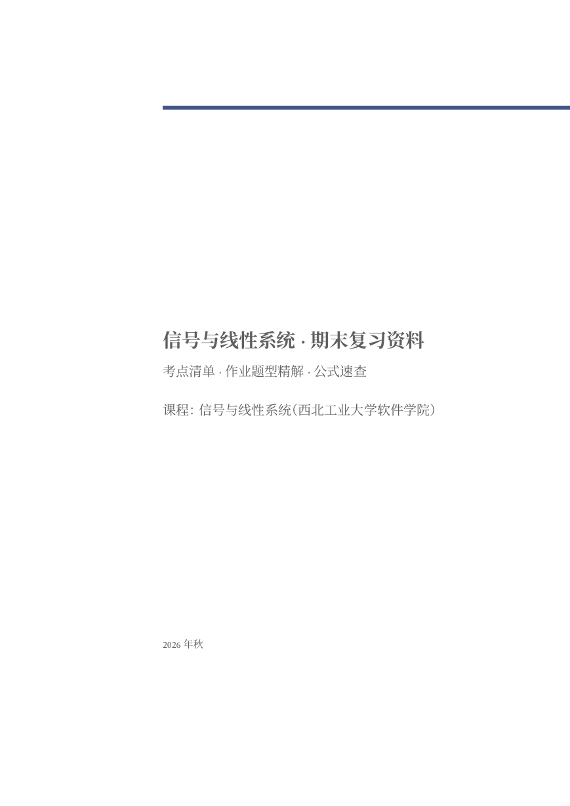
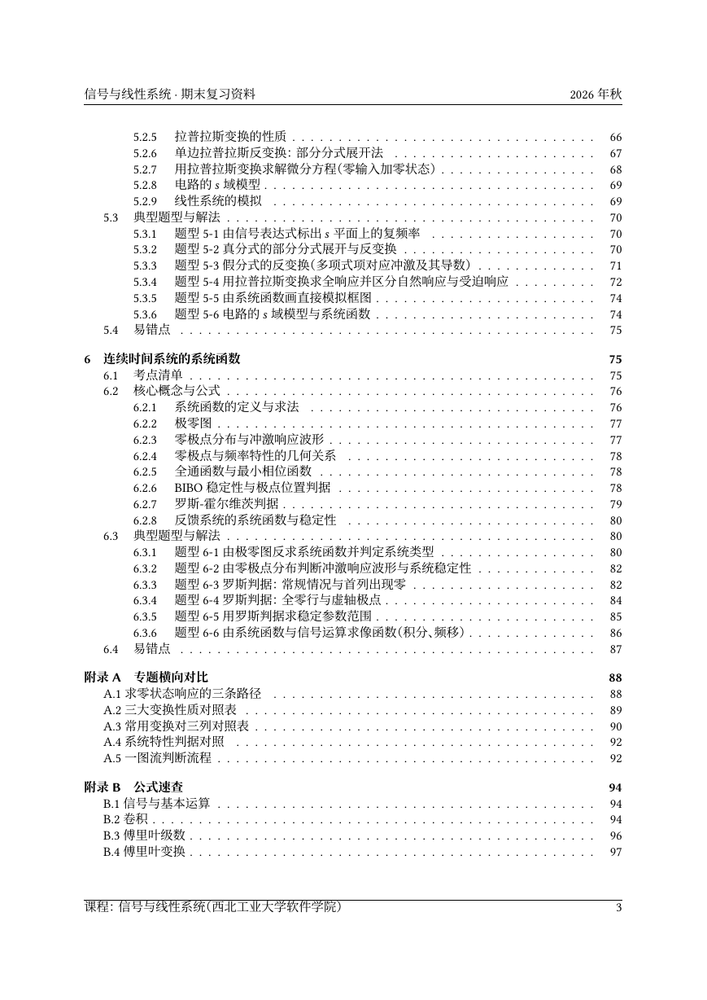
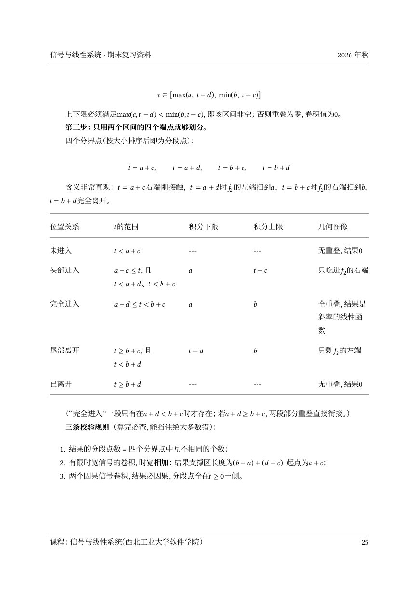

# 信号与线性系统 · 期末复习资料

> 西北工业大学软件学院《信号与线性系统》期末复习手册：**105 页 PDF**，六章考点清单、33 个题型精解、公式速查附录。源码是 Markdown，pandoc + LaTeX 一键成书。

<p align="center">
  <a href="https://github.com/ChillyWall/NWPU-Signals-and-Linear-Systems/releases/latest">
    <strong>📄 下载 PDF</strong>
  </a>
  ·
  <a href="#快速开始">自行构建</a>
  ·
  <a href="build/README.md">构建细节</a>
</p>

<p align="center"><em>
A Chinese study guide for <strong>Signals and Linear Systems</strong> (NWPU, School of Software),
written in Markdown and typeset with pandoc + LuaLaTeX + the Eisvogel template.<br>
Content: 6 chapters × (exam-point checklist / core formulas / 33 worked problem types / common pitfalls),
plus comparison and formula-reference appendices.
</em></p>



## 这是什么

一份按考试组织的复习资料，不是教材的摘要，而是把一门课压成**能查、能背、能照着做题**的三层结构。全书的骨架只有一句话：**给定激励与 LTI 系统，求响应**——时域靠卷积、频域靠 $H(\mathrm{j}\omega)$、复频域靠 $H(s)$，三套坐标描述同一件事。

| 层级 | 内容 |
|:---|:---|
| 每章开头 | **考点清单**：一张表说明考什么、怎么考、多重（★–★★★） |
| 每章主体 | **核心概念与公式**：结论 + 成立条件 + 性质表（全书 45 张表、466 个行间公式） |
| 每章核心 | **典型题型与解法**：题型特征 / 解题步骤 / 作业原题完整精解 / 同类题思路 |
| 每章收尾 | **易错点**：作业里真实踩过的坑 |
| 附录 A | 专题横向对比：同一问题的三条路径、三大变换性质对照、15 个信号的三列变换对、系统特性判据对照、选题决策树 |
| 附录 B | 公式速查：7 组表，考前一天翻的 |
| 附录 C | 易错点 46 条总汇，按概念 / 运算 / 记号三类 |

章节与课程一致：绪论 · 时域分析 · 正交分解（傅里叶级数）· 频域分析 · 复频域分析（拉普拉斯变换）· 系统函数（零极点与罗斯判据）。作业题解覆盖附加作业 1/2/3/4/6 全部题号，共 58 处引用。

## 预览

| 目录 | 卷积积分限：四界点判据 |
|:---:|:---:|
|  |  |

## 快速开始

### 依赖

| 依赖 | 版本 / 说明 |
|:---|:---|
| [pandoc](https://pandoc.org/) | 3.x（开发时用 3.7） |
| [Eisvogel 模板](https://github.com/Wandmalfarbe/pandoc-latex-template) | `eisvogel.latex` 放进 pandoc 数据目录的 `templates/`（Linux 默认 `~/.local/share/pandoc/templates/`） |
| [pandoc-crossref](https://github.com/lierdakil/pandoc-crossref) | 放进 `PATH`，或放到 pandoc 数据目录的 `filters/`（脚本按 PATH → `$PANDOC_DATA_DIR` → XDG 默认目录依次探测） |
| TeX Live | 需 `lualatex`、`latexmk`；含 KOMA-Script、`luatexja`、`booktabs`、`longtable` |
| 字体 | 中文 **Noto Serif CJK SC**，西文 **Libertinus Serif / Sans / Mono / Math** |

Debian/Ubuntu 上大致是：

```bash
sudo apt install pandoc texlive-luatex texlive-latex-extra texlive-lang-chinese \
                 fonts-noto-cjk fonts-libertinus

# Eisvogel 模板（pandoc 数据目录，Linux 默认为 ~/.local/share/pandoc）
PANDOC_DIR="${PANDOC_DATA_DIR:-${XDG_DATA_HOME:-$HOME/.local/share}/pandoc}"
mkdir -p "$PANDOC_DIR/templates"
curl -L -o "$PANDOC_DIR/templates/eisvogel.latex" \
  https://raw.githubusercontent.com/Wandmalfarbe/pandoc-latex-template/master/eisvogel.latex
```

> 模板与字体是两条硬约束：换字体要改 `build/build.sh` 里的 `-V CJKmainfont`；换模板要保证它仍有 `$body$` 占位，否则脚本里的 `\input{body}` 校验会直接报错退出。

### 构建

```bash
git clone https://github.com/ChillyWall/NWPU-Signals-and-Linear-Systems.git
cd NWPU-Signals-and-Linear-Systems
bash build/build.sh          # -> out/signal-linear-review.pdf
```

单次构建约 20 秒（首次会慢一些，`luaotfload` 要建字体缓存）。脚本会打印页数、错误数、缺字数与溢出统计，任何一项异常都以非 0 退出。

## 仓库结构

```
src/                      ← 唯一真源，按章拆成 10 份分册，文件名排序即正文顺序
  00-前言.md
  01-绪论.md … 06-系统函数.md
  07-附录A-专题横向对比.md  08-附录B-公式速查.md  09-附录C-易错点.md
build/
  build.sh                ← 五步流水线：逐份转 tex → 拼接 → 生成主文件 → 编译 → 校验
  stub-body.md            ← 正文占位符（一行 \input{body}），不要删
  header.tex              ← 中文首行缩进、表格行高、luatexja 断行参数
  README.md               ← 参数逐条解释 + 分册构建的三个坑
out/                      ← 构建产物（已提交，可直接下载）
  signal-linear-review.pdf / 信号与线性系统-复习资料.pdf
  signal-linear-review.tex
docs/                     ← README 用的预览图
work/
  header.yaml             ← 文档元数据（标题/作者/日期/纸张/行距）唯一定义处
  STYLE.md                ← 写作规范：结构模板、术语与记号统一表、数学书写红线
  reports/                ← 撰写阶段的交付报告（含视觉核对记录、遗留问题）
  skeleton.md             ← 管线自检用骨架
```

## 排版规格

| 项目 | 取值 |
|:---|:---|
| 引擎 | `latexmk` + `lualatex`（LuaTeX） |
| 模板 | Eisvogel（KOMA-Script `scrartcl`），封面 / 目录 / 页眉页脚 |
| 中文 | `Noto Serif CJK SC`，`luatexja` 分支，首行缩进 2 字符，行距 1.4 |
| 西文 / 数学 | Libertinus Serif / Sans / Mono / Math |
| 交叉引用 | `pandoc-crossref` 已接入；编号前缀置空，由正文书写 |
| 页面 | A4，公式不缩排，表格 booktabs 风格 |

## 为什么正文拆成 10 份

4400 行的单文件难以维护，所以按一级标题拆分。构建时**每份单独 pandoc 成"正文片段"**（不带导言区），再拼成 `body.tex`，由模板生成的主文件用 `\input{body}` 引入——因为 pandoc 一次只能产出一个完整文档。

这么拆会踩三个坑，仓库里都已处理（细节见 [`build/README.md`](build/README.md)）：

| 坑 | 现象 | 处理 |
|:---|:---|:---|
| 片段没有导言区 | `Environment longtable undefined`（宏包由 pandoc 按"文档含表"条件注入） | 生成主文件时加 `-V tables=true` |
| `\input{body}` 定位 | 找不到 `body.tex`（lualatex 的工作目录是仓库根） | 编译前 `export TEXINPUTS=build/tmp:` |
| 分册各自生成标题锚点 | 六章同名的"考点清单/易错点"产生重复 `\label`，目录链接指向错页 | 片段转换关闭 `markdown-auto_identifiers` |

## 已知限制

- **体量** 105 页，超出最初 60–80 页的预估；题型全部按四块展开是主要原因。
- **少数题面依赖原卷位图**：附加作业 1 第 9/10 题的波形刻度、附加作业 2 第 2 题的 $x(t)$ 形状，正文只给方法与已确认的解答数据，未虚构坐标。
- **第 6 章课件是学生版**，罗斯判据递推、两个例题完整表、反馈系统一节按标准教材补齐，逐条记在 `work/reports/part3.report.md`。
- **信号流图与梅森公式**在课件中未涉及，故未收录。
- 代码块无底色框（Eisvogel 的 `Shaded` 是空环境）；本文档不使用代码块，无影响。

## 来源与致谢

- 课程：西北工业大学软件学院《信号与线性系统》（2026 版课件）。
- 教材体系：郑君里《信号与系统》。
- 本仓库**不包含**课程原始课件与作业 PDF；正文是基于课堂内容的个人整理与再表述，作业题为自行推导并回代验算的结果，**不是官方答案**。若与课堂或教师讲法不一致，以官方材料为准。

## 许可证

本仓库是混合内容，按两部分授权：

| 范围 | 许可证 |
|:---|:---|
| 构建脚本、配置与文档辅助（`build/`、`work/`、`docs/`） | [MIT](LICENSE) |
| 复习资料正文与生成的 PDF（`src/`、`out/`） | [CC BY-NC-SA 4.0](LICENSE-docs) |

转载或改编正文请保留署名并注明出处，且不得用于商业目的。课程课件、作业原卷及其解答的著作权归原作者与授课单位所有。

## 贡献

欢迎勘误，尤其是公式错误、计算错误与记号不一致：

1. 直接改 `src/` 下对应的分册（一份分册 = 一章，便于定位）；
2. 提交前跑一次 `bash build/build.sh`，确认 0 error、0 缺字、无新增 Overfull；
3. PR 描述写明涉及章节与题号；改动公式请附推导或验算过程。

写作约定（结构模板、记号统一表、数学书写红线）见 [`work/STYLE.md`](work/STYLE.md)，新增章节请沿用。
